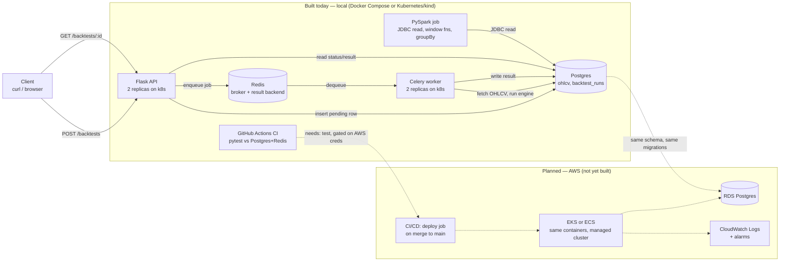

# Architecture

This documents what's actually built and running -- a local stack (Flask
API, Celery worker, Postgres, Redis) runnable either via Docker Compose
(day-to-day dev) or as a Kubernetes deployment (verified locally via
kind: Deployments, Services, a migration Job, load-balanced replicas,
self-healing), plus CI in GitHub Actions and a PySpark job for
cross-sectional analysis -- versus what's designed for but not yet
deployed (RDS, ECS/EKS, CloudWatch alarms, auto-deploy, all of which need
an actual AWS account). The diagram is honest about the split -- dashed
lines and the "planned" subgraph are nothing that exists yet.

## Diagram

## Request flow (what happens on `POST /backtests`)

1. Client posts `{ticker, start, end, strategy, strategy_params}`.
2. Flask validates the payload synchronously (missing fields, unknown
   strategy) -- cheap checks stay on the request thread, nothing here
   touches yfinance or runs a backtest.
3. Flask inserts a `backtest_runs` row with `status='pending'` and calls
   `run_backtest_task.delay(run_id, payload)`, which publishes a message
   to Redis. The route returns `202 {id, status: "pending"}` in
   milliseconds.
4. A Celery worker process (separate from the API, polling Redis) picks up
   the message, sets `status='running'`, calls the same `run_backtest()`
   function the API used to call inline, and writes `status='completed'`
   (with the result) or `status='failed'` (with the error) back to the
   same row.
5. The client polls `GET /backtests/:id`, which only ever reads Postgres
   -- it has no idea Celery exists.

## Decisions and tradeoffs

**SQLite → Postgres.** SQLite needed zero setup for a
single-process prototype fetching one ticker at a time. It doesn't hold up
once more than one process writes concurrently (a request thread and a
worker process, in this design) -- SQLite serializes writers at the file
level, which is a bottleneck and a source of `database is locked` errors
under real concurrency. Postgres handles concurrent writers properly and
is what RDS offers anyway, so the swap now avoids a second migration
later. Schema changes go through `migrations/*.sql` + `scripts/migrate.py`
rather than ad hoc DDL, so the identical path applies to RDS.

**Synchronous API → async via Celery/Redis.** The first cut
of `POST /backtests` ran the backtest inline and returned the full result.
That's fine for a few hundred bars; it falls over once a backtest spans
years of data with a 1,000-resample bootstrap, which can take minutes --
no HTTP client keeps a connection open that long, and most load balancers
and proxies will time it out well before that. The fix is the standard
one: return immediately with a job id, do the work on a separate worker,
let the client poll. Redis is both the message broker (queue) and result
backend here; Postgres is still the source of truth for state, so a
client never needs to know Celery is involved.

**Structured JSON logs.** Every log line -- HTTP requests, job
start/complete/fail -- is JSON on stdout. Locally that's just readable
JSON; once this runs on ECS, the awslogs log driver ships the exact same
stdout to CloudWatch Logs without any code change. The payoff is CloudWatch
Logs Insights queries on structured fields (`run_id`, `strategy`,
`duration_ms`) instead of regexing free text, and alarms that can key off
a real signal (e.g. rate of `backtest_failed` events) instead of just "is
the process alive."

**CI without CD.** GitHub Actions runs the full pytest suite
against real Postgres + Redis service containers on every push --
verified green in this repo. The auto-deploy half doesn't exist
yet because there's no ECS/ECR target to deploy to and no AWS credentials
configured as repo secrets. Adding it later is additive: a `deploy` job
gated on `needs: test`, using `aws-actions/configure-aws-credentials`,
`docker build` + push to ECR, then `aws ecs update-service`. Nothing about
the existing `test` job changes.

**Kubernetes orchestration, verified locally via kind.** The same
containers `docker compose` runs also run as Kubernetes Deployments/
Services (`k8s/`), on a local cluster created with `kind` (Kubernetes-
in-Docker -- nodes are just containers on the same Docker daemon
everything else uses, no separate VM). This was applied and tested live,
not just written:
- `kubectl apply -f k8s/` brought up Postgres, Redis, a one-shot
  migration `Job`, and 2 replicas each of the API and worker as
  Deployments.
- Confirmed the API `Service` load-balances across both API pods (pod
  logs show each pod serving different requests) and that the two worker
  pods compete for jobs off the same Redis queue -- only one worker's
  logs show `backtest_started`/`backtest_completed` for a given job, the
  standard competing-consumers pattern, now actually running across
  separate pods instead of one process.
- Deleted a running worker pod (`kubectl delete pod worker-...`) and
  watched the Deployment controller replace it automatically within
  seconds, with zero supervisor code of our own -- the concrete
  difference between orchestration and `docker run`.

`docker compose` remains the day-to-day dev loop (simpler, no cluster to
manage) -- the k8s path exists to demonstrate the actual primitives
(replica reconciliation, Service load-balancing, Jobs) against a real
cluster, matching what the eventual AWS deployment (EKS, or ECS if that
path is chosen instead) would need.

**What AWS would still add, concretely:**

| Local today | AWS (planned) |
|---|---|
| `docker compose up -d postgres` or the k8s `postgres` Deployment | RDS Postgres instance |
| `docker compose up -d redis` or the k8s `redis` Deployment | ElastiCache Redis (or keep Redis in-cluster) |
| `kind` cluster (local, ephemeral) | EKS (managed control plane) or ECS |
| JSON logs on stdout, read via `kubectl logs` | Same stdout, shipped to CloudWatch Logs by the cluster's log driver |
| Manual `git push` | GitHub Actions deploy job on merge to main |

## Current state

| Component | Status |
|---|---|
| Data layer, backtest engine, metrics, strategies | Done |
| Postgres migration | Done, verified live |
| Flask API | Done, verified live |
| Redis + Celery async jobs | Done, verified live end-to-end |
| CI (GitHub Actions) | Done, green. CD not yet (no AWS target) |
| Monitoring | Structured JSON logging done; CloudWatch alarms need AWS |
| PySpark cross-sectional analysis | Done, verified live -- 34 tickers/9 sectors via JDBC + window functions |
| Kubernetes orchestration | Done, verified live locally via kind -- not EKS/ECS |
| AWS deployment (RDS, EKS/ECS) | Planned |

49 tests pass locally and in CI. The repo is at
[github.com/skpallaka/quant-backtester](https://github.com/skpallaka/quant-backtester).
