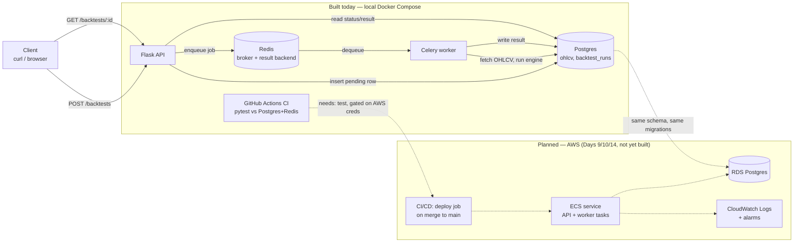

# Architecture

This documents what's actually built and running (a local Docker Compose
stack: Flask API, Celery worker, Postgres, Redis, CI in GitHub Actions)
versus what's designed for but not yet deployed (RDS, ECS, CloudWatch
alarms, auto-deploy). The diagram below is honest about the split --
dashed lines and the "planned" subgraph are nothing that exists yet.

## Diagram

## Request flow (what happens on `POST /backtests`)

1. Client posts `{ticker, start, end, strategy, strategy_params}`.
2. Flask validates the payload synchronously (missing fields, unknown
   strategy) -- cheap checks stay on the request thread, nothing here
   touches yfinance or runs a backtest.
3. Flask inserts a `backtest_runs` row with `status='pending'` and calls
   `run_backtest_task.delay(run_id, payload)`, which publishes a message
   to Redis. The route returns `202 {id, status: "pending"}` in
   milliseconds.
4. A Celery worker process (separate from the API, polling Redis) picks up
   the message, sets `status='running'`, calls the same `run_backtest()`
   function the API used to call inline, and writes `status='completed'`
   (with the result) or `status='failed'` (with the error) back to the
   same row.
5. The client polls `GET /backtests/:id`, which only ever reads Postgres
   -- it has no idea Celery exists.

## Decisions and tradeoffs

**SQLite → Postgres (Day 8).** SQLite needed zero setup for a
single-process prototype fetching one ticker at a time. It doesn't hold up
once more than one process writes concurrently (a request thread and a
worker process, in this design) -- SQLite serializes writers at the file
level, which is a bottleneck and a source of `database is locked` errors
under real concurrency. Postgres handles concurrent writers properly and
is what RDS offers anyway, so the swap now avoids a second migration
later. Schema changes go through `migrations/*.sql` + `scripts/migrate.py`
rather than ad hoc DDL, so the identical path applies to RDS.

**Synchronous API → async via Celery/Redis (Days 10-11).** The first cut
of `POST /backtests` ran the backtest inline and returned the full result.
That's fine for a few hundred bars; it falls over once a backtest spans
years of data with a 1,000-resample bootstrap, which can take minutes --
no HTTP client keeps a connection open that long, and most load balancers
and proxies will time it out well before that. The fix is the standard
one: return immediately with a job id, do the work on a separate worker,
let the client poll. Redis is both the message broker (queue) and result
backend here; Postgres is still the source of truth for state, so a
client never needs to know Celery is involved.

**Structured JSON logs (Day 14).** Every log line -- HTTP requests, job
start/complete/fail -- is JSON on stdout. Locally that's just readable
JSON; once this runs on ECS, the awslogs log driver ships the exact same
stdout to CloudWatch Logs without any code change. The payoff is CloudWatch
Logs Insights queries on structured fields (`run_id`, `strategy`,
`duration_ms`) instead of regexing free text, and alarms that can key off
a real signal (e.g. rate of `backtest_failed` events) instead of just "is
the process alive."

**CI without CD (Day 13).** GitHub Actions runs the full pytest suite
against real Postgres + Redis service containers on every push --
verified green in this repo. The auto-deploy half of Day 13 doesn't exist
yet because there's no ECS/ECR target to deploy to and no AWS credentials
configured as repo secrets. Adding it later is additive: a `deploy` job
gated on `needs: test`, using `aws-actions/configure-aws-credentials`,
`docker build` + push to ECR, then `aws ecs update-service`. Nothing about
the existing `test` job changes.

**What AWS would replace, concretely:**

| Local today | AWS (planned) |
|---|---|
| `docker compose up -d postgres` | RDS Postgres instance |
| `docker compose up -d redis` | ElastiCache Redis (or keep Redis on the ECS task) |
| `flask run` | ECS service running the Flask container |
| `celery worker --pool=solo` | ECS service running the worker container |
| JSON logs on stdout, read from a terminal | Same stdout, shipped to CloudWatch Logs by awslogs driver |
| Manual `git push` | GitHub Actions deploy job on merge to main |

## Current state

| Day | Item | Status |
|---|---|---|
| 1-7 | Data layer, backtest engine, metrics, strategies | Done, 37 tests |
| 8 | Postgres migration | Done, verified live |
| 9 | AWS account / RDS / IAM | Not started (needs your AWS credentials) |
| 10 | Flask API | Done, verified live |
| 11 | Redis + Celery async jobs | Done, verified live end-to-end |
| 12 | Buffer | Used as a clean-restart regression check (nothing AWS to fix) |
| 13 | CI | Done, green on GitHub Actions. CD half blocked on Day 9/10 |
| 14 | Monitoring | Structured logging done; CloudWatch alarms blocked on Day 9 |
| 15 | Docs | This file |
| 16 | Review | Next |

49 tests pass locally and in CI. The repo is at
[github.com/skpallaka/quant-backtester](https://github.com/skpallaka/quant-backtester).
